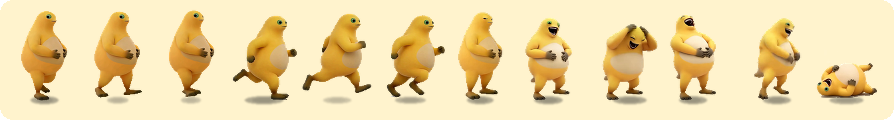

# 奶蛙 Mac 版 · Naiwa for macOS

> 让满屏奶蛙在 Mac 桌面上跑来跑去。鼠标冲过去它就逃，点中它就原地爆笑、躺平、放烟花。



## 灵感来源

这个项目的灵感和素材来自 **[22hewang/naiwa-ultimate](https://github.com/22hewang/naiwa-ultimate)**（「奶蛙极致版 3.0」，让 9999 只奶蛙在桌面上一起爆笑）。

原版只发布了 Windows 的 exe。它用 Python 写成，靠 Win32 分层窗口、OpenGL 和 waveOut 实现，Mac 上跑不了。所以这里照着原版的玩法和手感，用 Swift 和 SpriteKit 重新写了一个 Mac 原生版本。

- 奶蛙的动画帧（走 8 帧、跑 8 帧、笑 133 帧）和笑声、爆炸声都取自原版的发布包。形象和音效的版权归原作者。
- 原版代码里的说明提到，它是在更早的「奶蛙」桌宠基础上加的控制条和性能优化。感谢这一路的作者们。
- 本仓库只是非商业的移植，和原作者没有合作关系。原作者如果对这个移植有意见，请开 issue，我会及时处理。

## Mac 适配

| | Windows 原版 | 这个 Mac 版 |
|---|---|---|
| 画面 | 每只奶蛙一个分层窗口，后来改成 OpenGL 合批 | 一整块透明、置顶的覆盖层，SpriteKit 图集合批绘制，几千只同屏也流畅 |
| 点击穿透 | 逐像素透明窗口 | 只有鼠标压在奶蛙身上（按像素透明度判断，脚下影子不算）时才接点击，其余地方点击直接落到下面的程序 |
| 托盘 | 系统托盘图标 | 菜单栏图标，不占 Dock |
| 控制条 | 右下角，4 秒不动会滑到屏幕边 | 右下角毛玻璃控制条，可以拖动；× 收起，从菜单栏或 ⌃⌥P 叫回 |
| 声音 | waveOut 软件混音 | AVAudioPlayer 声音池：笑声最多 12 层、爆炸 6 层，几千只一起笑也不卡 |
| 烟花 | PIL 预渲染的帧 | SpriteKit 粒子，同时最多 160 朵，超出的改成小闪光 |
| 热键 | Ctrl+Alt+Q / N / P | ⌃⌥Q 退出 / ⌃⌥N 召唤一只 / ⌃⌥P 显示或收起控制条 |
| 多空间 | — | 切换桌面空间、全屏 App 上都能看到 |

手感和原版一致：走路和逃跑的速度曲线、鼠标多近多快会惊动它（反应时间 0.14 秒）、笑的 15 帧/秒、躺平那一刻收声，这些数值都照搬原版。

和原版不一样的几处：

- 原版的「开溜」按钮改叫「退出」，因为太容易被当成别的功能误点。
- 批量召唤的奶蛙会跑到屏幕里的随机位置再开始闲逛。原版是贴着左右边缘停下，几百只会挤成两列。
- 逃跑时一直用跑步动作。
- 多了大小选项：小、中、大。

## 安装

1. 到 [Releases](../../releases) 下载 `Naiwa-mac.zip`，解压后把「奶蛙.app」拖进「应用程序」。
2. 第一次打开时 macOS 会拦下（没有付费的苹果开发者签名）。打开「系统设置 → 隐私与安全性」，在页面下方点「仍要打开」。也可以在终端运行：
   ```bash
   xattr -dr com.apple.quarantine /Applications/奶蛙.app
   ```
3. 需要 macOS 13 或更新的系统。Apple 芯片和 Intel 的 Mac 都能用。

## 玩法

- 每隔一段时间（默认 15 秒）会从屏幕左右边缘跑进来一只，可以同时有很多只。
- 鼠标慢慢挪过去它不太察觉；冲得太快或贴得太近，它会加速逃跑。
- 点中就算抓到：它原地爆笑，躺平，放一朵烟花后消失，「已抓」加 1。
- 跑出屏幕左右边缘就算逃走，不会再回来。
- 控制条：
  - 召唤 1 / 10 / 100 / 999 只，或者自定义数量（最多 9999）
  - 仙乐：全场奶蛙一起笑
  - 瞬爆：全场一只接一只放烟花
  - 清屏、音效开关、大小、自动出现的间隔（也可以选「不自动」）

不联网，也不读写桌面上的任何文件。只会在偏好设置里记住「已抓」数和你的设置，并在 `~/Library/Logs/奶蛙.log` 里记下启动、点中和退出这几件事。

## 从源码编译

需要 Xcode 命令行工具（`xcode-select --install`）。

```bash
./build.sh                 # 输出 build/奶蛙.app（同时支持 Apple 芯片和 Intel）
./build.sh /Applications   # 编译并装进「应用程序」
```

代码只有一个文件：`Sources/main.swift`。素材在 `Resources/`。`tools/pyi_extract.py` 是当时拆原版 PyInstaller 包用的脚本，它只解析文件，不运行里面的代码。

## 许可

和原版一样，采用 [PolyForm Noncommercial 1.0.0](LICENSE)：

- 可以：免费下载、自己玩、免费分享给朋友、为了非商业目的修改。
- 不可以：出售，用于任何商业用途，拿它换取任何形式的报酬（包括广告分成、打赏募资、付费下载站）。
- 转发时请保留本许可，以及原作者 [22hewang/naiwa-ultimate](https://github.com/22hewang/naiwa-ultimate) 的署名。

---

**English.** A native macOS port of [22hewang/naiwa-ultimate](https://github.com/22hewang/naiwa-ultimate), a Windows-only desktop toy where hundreds of laughing frogs run around your screen. This port is rewritten in Swift + SpriteKit as one transparent, click-through overlay, with a menu bar item, global hotkeys (⌃⌥Q / N / P) and the original's movement and timing constants. Frog sprites and sounds come from the original release and belong to their authors. Noncommercial use only, under the same PolyForm Noncommercial 1.0.0 license.
